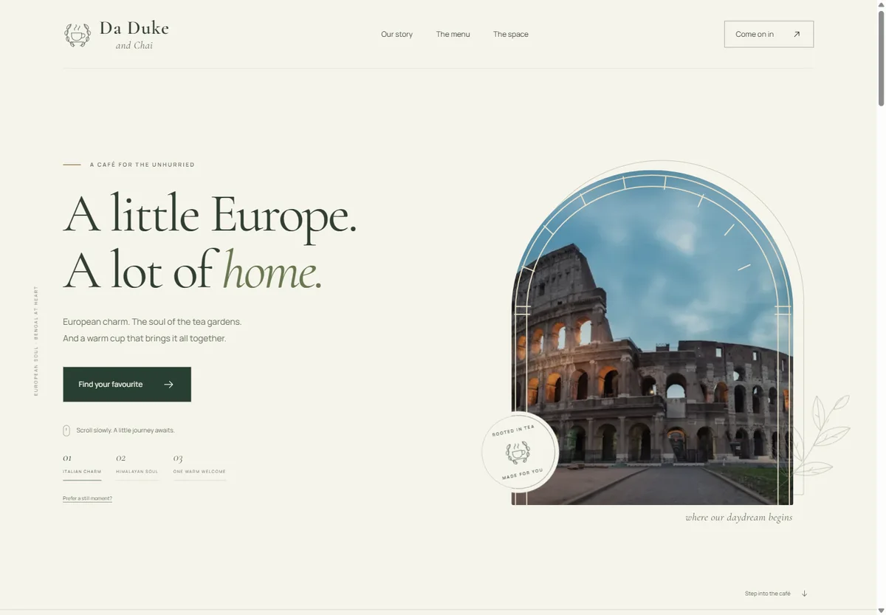

# Da Duke and Chai

A little Europe. A lot of home.

A complete, responsive café concept built with **Next.js 16, React 19, TypeScript, and Tailwind CSS 4**, ready for Vercel. Warm ivory, forest green, botanical linework, and Roman arches bring European café culture together with the tea traditions of Assam and North Bengal. The original logo is preserved in `old logo.jpeg` and featured on the Story page.



The journey continues [into the Himalayas](docs/preview/home-mountains.webp) and [home to the café](docs/preview/home-cafe.webp). Preview the [Menu](docs/preview/page-menu.webp), [Story](docs/preview/page-our-story.webp), [Space](docs/preview/page-the-space.webp), and [Visit](docs/preview/page-visit.webp) pages, or the [phone homepage](docs/preview/mobile-home-final.webp).

## The five pages

- `/` — a scroll-driven journey through Rome, the Himalayas, and a welcoming café table, followed by a short introduction to the café.
- `/our-story` — the café’s inspiration, tea rituals, and original emblem.
- `/menu` — category filters, house favourites, and the complete illustrative menu with rupee prices.
- `/the-space` — an inspiration gallery with a keyboard-accessible image viewer and notes on the atmosphere.
- `/visit` — a working sample visit planner and answers to common questions.

The hero follows ordinary page scrolling; it does not trap the wheel or touch gestures. Scene buttons, a skip link, a still-view control, and system reduced-motion support provide alternatives.

## Run locally

Use **Node.js 22**. The current Tailwind toolchain requires a modern Node runtime; this laptop’s older Node 20.16 default cannot build it.

```sh
npm ci
npm run dev
```

Open `http://localhost:3000`. For a different port, use `npm run dev -- --port 3100`.

```sh
npm run lint
npm run build
npm run typecheck
npm start
```

The site needs no API keys or environment variables. Fonts and optimized photographs are bundled locally, so production does not contact Google Fonts or an external image service.

## Deploy to Vercel

1. Import [tirthankardgen-cell/Da-Duke](https://github.com/tirthankardgen-cell/Da-Duke).
2. Keep the repository root as the root directory and select the **Next.js** preset.
3. Select **Node.js 22.x**. Install: `npm ci`. Build: `npm run build`.
4. Deploy. Vercel serves all five routes directly; no SPA rewrite is needed.

`vercel.json` contains the framework and build settings. Social metadata uses Vercel’s supplied project URL when available. The source repository does not itself create a Vercel project or domain.

## Before using it for a real café

This is deliberately a sample website. Menu items and prices are illustrative. Photography represents the concept, not the actual café. No opening hours, street address, phone number, or operational booking service has been invented.

The visit planner validates names and dates and shows the chosen afternoon. It does **not** make a reservation, contact the café, or store personal information. Supply confirmed business details and connect a booking service before taking real reservations.

## Editing

- `src/lib/menu.ts` — dishes, descriptions, categories, and prices.
- `src/components/cafe.tsx` — shared navigation, footer, and café sections.
- `src/components/journey-hero.tsx` — scroll scenes and animation timing.
- `src/components/page-sections.tsx` — page introductions and expanded Story/Menu/Space content.
- `src/components/visit-planner.tsx` — the sample planner and visit FAQs.
- `src/app/globals.css`, `pages.css`, `journey.css` — styling and responsive behaviour.
- `public/images/` — optimized local assets, including the social sharing image.

See [design and image references](docs/REFERENCES.md) and [verification notes](docs/VERIFICATION.md). Browser captures are written to ignored `output/playwright/`; selected finished previews are included under `docs/preview/`.
