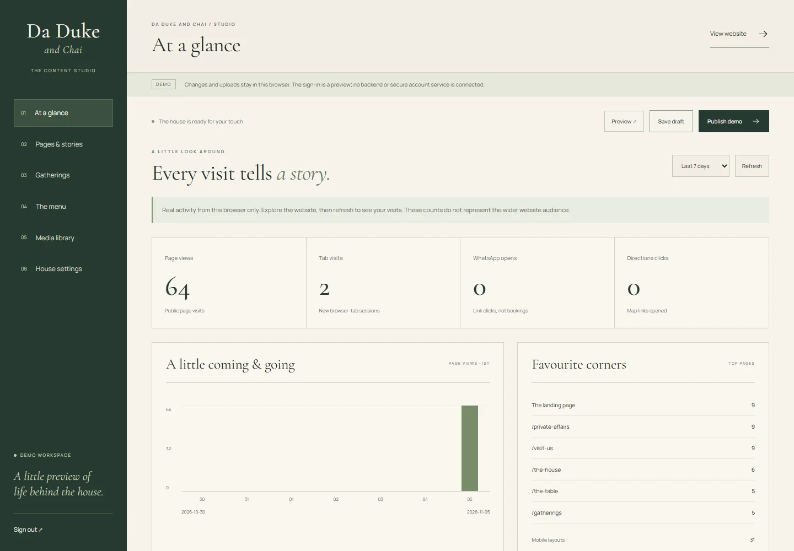

# Da Duke and Chai

A European state of mind. A Himalayan cup of soul.

A responsive **Next.js 16 / React 19 / TypeScript** café demo, updated from [the website brief](da_duke_and_chai_website_brief.md). This preview introduces an illustrated, page-turning storybook: **where the Alps meet the Himalayas**, and European café culture meets Assam and North Bengal. The public site and a working browser-only CMS are included. **No backend, database, booking service or payment system is connected.**


## The storybook preview

Branch: `codex/preview-alps-himalayas-book`.

The homepage takes its open-book direction from the supplied [Biryani Legends / photos reference](https://21stdev-my-components-one.vercel.app/#biryani-legends-template/photos). Original Alpine, Himalayan and tea illustrations, forest-green binding, textured paper, locally served type, and the café's existing licensed photographs create the Da Duke and Chai edition.

The website begins with a closed forest-green cover and waits for the visitor to open it. Click **Open the book**, use the forward arrow, or choose a chapter. The contents page travels with the inside of the cover as it opens; the flat left page appears only after the cover lands. The cover, pages, navigation and footer fit inside a single viewport, including shorter browser windows. Turn complete spreads with the chapter navigation, contents list, arrow buttons, keyboard arrows, a mouse wheel over the book, or a horizontal swipe. Each chapter has a shareable hash such as `/#himalayas`. Browser back/forward restores the chapter, and older `/#himalayas/right` links resolve to the complete spread. **Pause motion** and the system reduced-motion setting stop the ambient, opening and page-turn animations.

Phones and tablets give more space to the book, with a larger closed cover that settles into two facing pages when opened. Chapter navigation uses one horizontally scrollable row; the active chapter scrolls into view. The compact pages contain brief introductions, photographs and menu highlights. There is no separate reading row or chapter dialog. The desktop book keeps its existing dimensions. A **View menu** action stays available in the mobile header, including before the book opens.

In **Pages & stories**, edit the title page, dedication, Alps and Himalayas copy and photographs. Arrange or hide chapters in **The chapters of the book**. The table, house and visit chapters use the shared section copy; table highlights follow featured, available menu selections. Existing saved CMS content receives the new storybook defaults while retaining its edits. Draft preview and browser-local publication also apply to the storybook.

## Explore the demo

- `/` — the open storybook: contents and title page, the Alps, the Himalayas, the table, the house and a visit invitation. Chapters link to the complete menu, gatherings, journal and enquiry pages.
- `/the-house` — an editorial introduction to the concept and atmosphere.
- `/the-table` — a filterable concept menu, optional prices, availability and featured selections.
- `/gatherings` and `/gatherings/[slug]` — events published through the demo CMS, India-time dates, current/upcoming/archive sections and cancellation/postponement notices.
- `/private-affairs` — an optional occasion composer that prepares a WhatsApp message.
- `/visit-us` — location, hours, directions, contact details and FAQs.
- `/gallery` — collection filters and a keyboard-accessible image viewer.
- `/privacy`, `/terms` and a branded not-found page.
- `/admin` — the content studio. It is intentionally absent from public navigation.
- `/preview` — a separate view of saved drafts.

The original `/our-story`, `/menu`, `/the-space` and `/visit` URLs redirect permanently to the corresponding new pages. The optional journal is omitted until there is approved editorial content.

Original line drawings of **Alpine villages, Himalayan ridges, tea branches and a tea service** appear in the book. Faint **Eiffel Tower, Colosseum, mountain and tea outlines** fill the surrounding margins, with slow leaf, branch, cloud and star animations. These decorations sit behind the book and do not intercept gestures or move its text and photographs. Architectural drawings continue through the supporting pages. Motion can be paused and honours the system reduced-motion preference. The wordmark returns to the landing page; there is no “Home” navigation item.

## Try the CMS

Open `/admin` and use the publicly displayed demonstration credentials:

- **Email:** `owner@daduke.demo`
- **Password:** `ChaiWithDuke`

The “Use demo credentials” button fills the form. This is a demonstration of signing in, **not secure authentication**. Do not enter real passwords or confidential data.

The studio supports:

- **Overview:** actual page views, tab visits, WhatsApp-link clicks, directions clicks, popular pages and screen-size groups from this browser; 7- and 30-day views. No fabricated audience metrics.
- **Pages & stories:** edit the storybook, page headlines and introductions, shared section copy and images, House notes, and homepage chapter order/visibility.
- **Gatherings:** create and edit drafts, choose uploaded posters, validate unique slugs and date ranges, preview details, feature events, publish/unpublish, and set sold-out/cancelled/postponed states.
- **The menu:** edit categories, selections, descriptions, optional prices, dietary labels, availability, images and homepage features.
- **Media library:** upload or replace JPG/PNG/WebP/AVIF images, edit captions and alt text, select collection and crop focus, and reorder the gallery. Uploads are resized locally to at most 1600 pixels on the longest edge.
- **House settings:** edit contact details, hours, directions, WhatsApp number and template, occasions, venue information and an optional PDF menu link.

**Save draft** keeps changes separate from the website. **Preview** opens a saved draft. **Publish demo** updates the website in this browser, including other open tabs on the same origin. Closing or refreshing a tab retains saved content; clearing site storage removes it. A different device, browser profile, hostname or port has its own fresh demo.

Export the current draft as JSON from House settings before clearing storage or resetting. The demo’s shared credentials, browser storage and public draft previews must be replaced with real authentication, authorization, storage and publishing infrastructure before a production CMS is enabled.



## Enquiries and content boundaries

The occasion composer does not collect a name or phone number, save its fields, contact the café, reserve a seat or take a payment. With a configured number, it opens a correctly encoded `wa.me` link and the visitor must send the message in WhatsApp. Without a number, it offers an honest message preview.

No address, hours, phone number, operational capacity, event dates or prices have been invented. The initial event collection is empty. The menu is clearly labelled as a concept selection. Licensed stock photography is labelled as a moodboard, not the actual café or its suppliers.

The entire deployment uses `noindex` and a disallowing `robots.txt` while it is a demo. Page metadata and the sitemap are provided, but browser-only edits do not publish server-side metadata. Event links represent data in the current browser and are not shareable event records across devices.

## Run and verify

Use **Node.js 22**. On Windows, ensure Node 22 is first on `PATH` so Next.js workers use the same runtime.

```sh
npm ci
npm run dev
```

Open `http://localhost:3000`. An alternative port can be selected with `npm run dev -- --port 3210`.

```sh
npm run lint
npm test
npm run build
npm run typecheck
npm start
```

No API keys or environment variables are required. Fonts, photos and illustrations are served locally. GitHub Actions runs the lint, domain tests, production build and type checks.

To deploy to Vercel, import [tirthankardgen-cell/Da-Duke](https://github.com/tirthankardgen-cell/Da-Duke), use the Next.js preset and Node 22, with `npm ci` and `npm run build`. Deployment automation is separate from this repository’s local preview.

## Project guide

- `src/lib/content.ts` — typed initial content and the CMS data model.
- `src/components/demo-content.tsx` — local draft/publication store and cross-tab updates.
- `src/components/admin/` — demo sign-in, statistics and content/image/event editors.
- `src/lib/demo-analytics.ts` — local aggregate counts; no messages, visitor identifiers or remote tracking.
- `src/lib/site-utils.ts` — event timing, URL validation and WhatsApp message composition.
- `src/components/cafe.tsx`, `public-sections.tsx`, `gatherings.tsx`, `gallery.tsx`, `enquiry.tsx` — public experience.
- `src/components/storybook/` — responsive book, page turns, chapter navigation, original Alpine and botanical illustrations, and scoped styles.
- `src/components/heritage-sketch.tsx` — original architectural and landscape illustration work. The former scroll hero remains in `journey-hero.tsx` for reference.
- `src/app/` — routes, metadata and responsive styles.
- `scripts/site-utils.test.mjs` — event/date/enquiry contract tests.

See [storybook verification](docs/STORYBOOK-PREVIEW.md), [previous verification notes](docs/VERIFICATION.md) and [image/design references](docs/REFERENCES.md). Browser QA artifacts remain in ignored `output/playwright/`; selected previews are committed in `docs/preview/`. GitHub Actions also runs on `codex/preview-*` branch pushes.

Before a real launch, supply the brief’s approved business details, menu, photography, events and legal text, then replace demo access/local persistence with the separately scoped backend.

## The Carte demo

`/the-carte` is the food and drinks menu. On the supporting pages, the six public navigation links are The House, The Carte, Gatherings, Private Affairs, The Journal and Visit Us. The homepage uses the storybook's chapter navigation. `/the-table` and `/gallery` remain available for existing links; `/the-journal` uses the editable visual-journal content.

In `/admin`, use **The menu** to add/delete dishes, change categories, descriptions and prices, move items earlier/later, and set availability, seasonal, recommendation and signature labels. Category order follows the category list; reassign dishes before removing a category. Upload photos in **Media library**, then choose them on a dish. Set an optional PDF URL in **House settings**. **Preview** opens The Carte with the draft; **Publish demo** updates this browser's public view. Older saved drafts retain their content and receive the new Carte page introduction.

This is intentionally a client demonstration: content and uploaded images live in localStorage in this browser, not a shared database. Sample prices are illustrative. The demo login is not secure authentication and publishing does not update other visitors' browsers.
