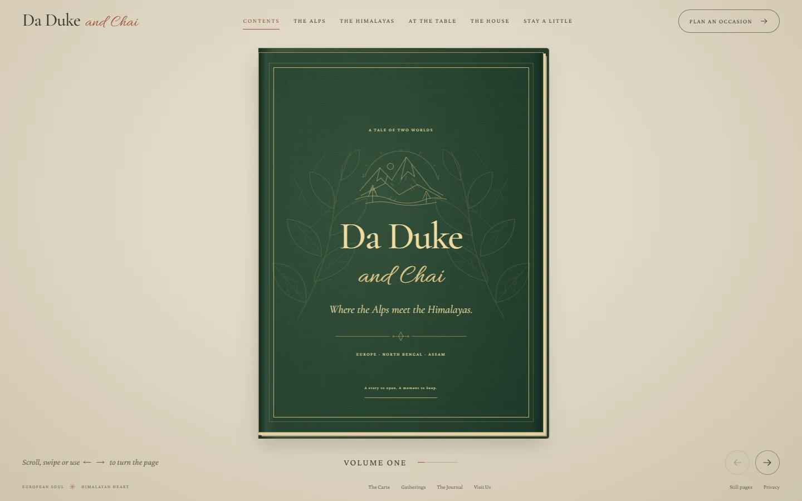
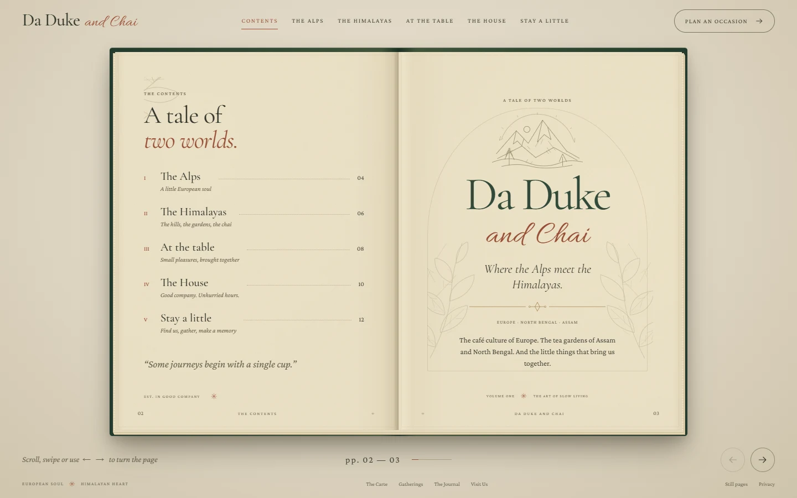
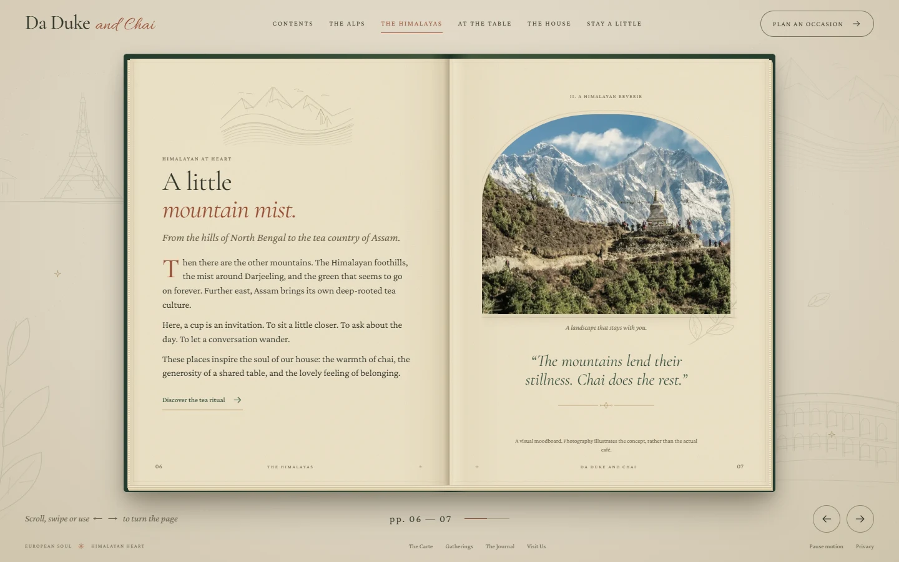

# Alps meet Himalayas — storybook preview

Preview branch: `codex/preview-alps-himalayas-book`.

The homepage is now an open book inspired by the user-supplied [Biryani Legends / photos template](https://21stdev-my-components-one.vercel.app/#biryani-legends-template/photos). It tells the Da Duke and Chai story through the Alps, the Himalayas, Assam and North Bengal, with a forest-green binding, textured paper, botanical linework and locally served typography.

## What is included

- A closed forest-green cover waits for the visitor to select **Open the book**, use the forward arrow, or choose a chapter. Its inside carries the left page while turning, so no flat left page or binding appears prematurely. The contents/title spread and five two-page chapters follow: The Alps, The Himalayas, At the table, The House, and Stay a little. Draft preview opens directly for editing.
- CSS 3D page turns, contents links, chapter buttons, previous/next controls, keyboard navigation, mouse-wheel navigation and horizontal touch swipes.
- Shareable chapter URLs such as `/#himalayas`, with browser back/forward support and focus restoration after leaving the contents page.
- The book and its controls occupy a single viewport. Its size follows both available width and height, with no minimum width that can force the book below the screen. Phones and tablets show one page at a time with previous/next controls, including a shareable `/right` chapter suffix. All initial content fits without scrolling; unusually long CMS edits retain keyboard-accessible overflow rather than losing text.
- System reduced-motion support and a separate **Still pages** control.
- Links to the complete menu, gatherings, journal, house, visit and private-enquiry experiences.
- Editable cover, dedication, Alps/Himalayas text and images in **Pages & stories**, plus chapter order and visibility. Remaining chapters use existing shared copy and featured, available menu items.
- Migration of older browser-local drafts and publications without discarding their existing page edits.
- GitHub Actions checks on `codex/preview-*` pushes.

## Verification

Verified on **5 November 2026**, using **Node 22.23.4**, Next.js 16.4.5 and Google Chrome through Playwright CLI.

- `npm run lint`, all **9 existing domain tests**, `npm run build`, `npm run typecheck`, and `git diff --check` pass.
- The final production browser run passes **49 interaction checks** and **90 page-layout checks** without overflow or JavaScript errors. It covers all six spreads at desktop, phone and tablet sizes, including **1440 × 900**, **1920 × 949**, **1280 × 633**, **390 × 844**, **320 × 740** and **768 × 1024**, plus shorter phone windows and landscape orientation. The shorter desktop viewport reproduces the browser proportions in the user's report.
- Axe checks for WCAG A/AA rules through WCAG 2.2 report no violations in the checked book layouts or the content editor at desktop and mobile widths. No JavaScript page errors or broken book images were found.
- Contents navigation, keyboard arrows, wheel turns, horizontal touch events, first/last boundaries, chapter deep links, browser history, reduced motion and focus restoration were exercised.
- **20 production HTTP routes** were checked. Public pages, CMS and draft preview return 200; the four legacy routes retain their 308 redirects; a missing ordinary page returns the branded 404.
- CMS checks confirm headline validation, saved-draft isolation, the actual preview button, image selection, publication into another open tab, chapter order/visibility after reload, and preservation of existing edits when loading an older content snapshot.
- The original right-page jitter was reproduced in headed Chrome: the overflow flag flipped **178–179 times** while scrollbar width repeatedly resized the photographs. A stable scrollbar gutter now keeps the layout independent of that measurement. The [corrected table spread](preview/storybook-table.webp) records **zero** width/position changes and no page overflow at the three reported desktop sizes.
- Opening checks confirm that the cover remains closed until activated, followed by **closed → opening → open**, with the flat left page hidden throughout the turn. Frame samples on desktop and phone confirm that only the [printed inside of the moving cover](preview/storybook-opening.webp) is revealed during the opening. Chapter deep links survive opening, and reduced motion uses **closed → open** on activation without a 3D transition. A short wheel cooldown also prevents one trackpad gesture racing through several pages.
- Long-copy checks confirm that the text remains reachable, reading it does not accidentally turn the chapter, and the next chapter starts at the top. Temporary CMS fixtures were removed from the QA browser after verification.

Full screenshots, downloaded reference material and browser QA scripts are kept in ignored `output/`. Selected compressed screenshots are committed under `docs/preview/`.

## Scope

This is the existing frontend/CMS demonstration on a separate preview branch. Browser-local content, demonstration sign-in, concept menu notices, photography disclosures and unconfirmed business details retain their existing boundaries. There is no new booking, payment or backend service.

The photographs retain their existing licences; the new line drawings and paper treatment are original. See [references](REFERENCES.md) for provenance. Chrome viewport and touch-event checks do not substitute for physical-device, Safari, Firefox or screen-reader testing.
