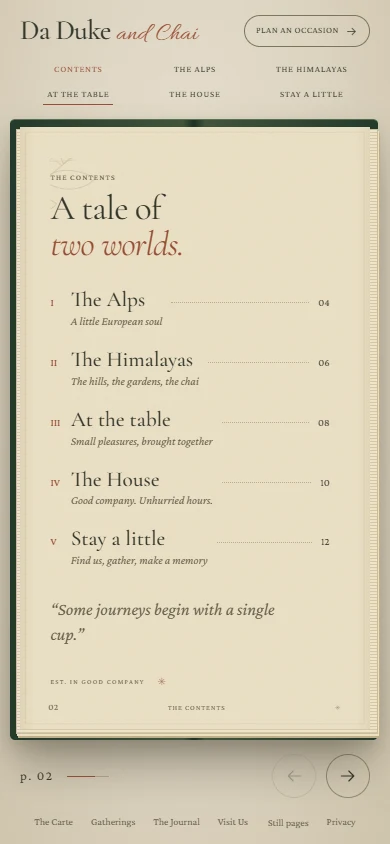
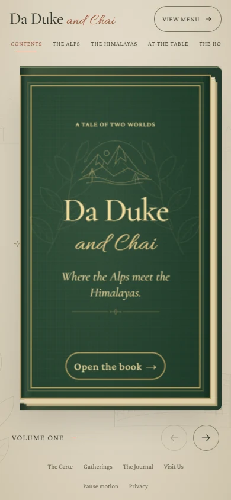
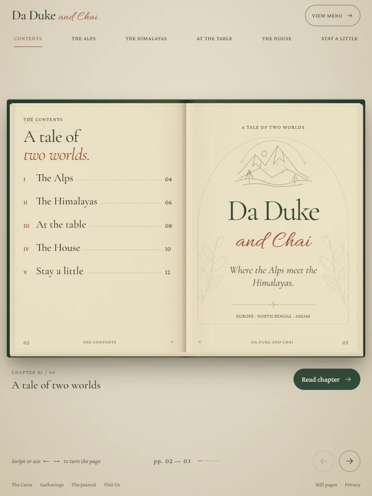

# Alps meet Himalayas — storybook preview

Preview branch: `codex/preview-alps-himalayas-book`. [Open the Vercel preview](https://da-duke-git-codex-preview-alps-himalayas-book-tirthankar-s.vercel.app).

The homepage is an illustrated book inspired by the user-supplied [Biryani Legends / photos template](https://21stdev-my-components-one.vercel.app/#biryani-legends-template/photos). It tells the Da Duke and Chai story through the Alps, the Himalayas, Assam and North Bengal, with a forest-green binding, textured paper, botanical linework and locally served typography.

## What is included

- A closed forest-green cover waits for the visitor to select **Open the book**, use the forward arrow, or choose a chapter. Its inside carries the left page while turning, so no flat left page or binding appears prematurely. The contents/title spread and five chapters follow: The Alps, The Himalayas, At the table, The House, and Stay a little. Draft preview opens directly for editing.
- A larger mobile/tablet cover and open book, with both facing pages visible, including in landscape orientation. The desktop book keeps its existing dimensions. Compact pages contain short introductions, photographs and menu highlights; the separate reading row and reader dialog have been removed.
- One compact, horizontally scrollable row of chapter links on phones. The selected chapter stays in view when turning pages or resizing the screen. **View menu** remains available in the header.
- Faint Eiffel Tower, Colosseum, mountain and tea illustrations in the margins. Leaves, branches, clouds and small stars move slowly. This decorative layer is hidden from assistive technology, does not intercept input and does not affect book layout.
- A single viewport for the cover, book, navigation and footer. Compact pages do not scroll; unusually long desktop CMS copy retains keyboard-accessible page overflow.
- CSS 3D opening and page turns on every screen size, contents links, chapter buttons, previous/next controls, keyboard navigation, mouse-wheel navigation and horizontal touch swipes.
- Shareable chapter URLs such as `/#himalayas`, with browser back/forward support. Older `/#himalayas/right` links now open the complete spread.
- System reduced-motion support and a **Pause motion / Enable motion** control for both ambient motion and page animations. Both preserve the visitor's choice of when to open the cover.
- **View menu** in the mobile/tablet header, available before opening the book, plus links to the complete menu, gatherings, journal, house, visit and private-enquiry experiences.
- Editable cover, dedication, Alps/Himalayas text and images in **Pages & stories**, plus chapter order and visibility. Remaining chapters use existing shared copy and featured, available menu items.
- Migration of older browser-local drafts and publications without discarding their existing page edits.
- GitHub Actions checks on `codex/preview-*` pushes.

## Verification

Verified on **5 November 2026**, using **Node 22.23.4**, Next.js 16.4.5 and Google Chrome through Playwright CLI, against the final production build.

- `npm run lint`, all **9 existing domain tests**, `npm run build`, `npm run typecheck`, and `git diff --check` pass.
- **42 interaction checks** cover manual opening, the moving inside cover, phone page-turn animation, native Chrome touch swipes, keyboard/wheel turns, first/last boundaries, browser history, legacy chapter links, compact navigation, resizing, reduced motion, ambient motion controls, reader removal and the mobile menu link.
- **84 spread-layout checks** and **14 cover-layout checks** pass. Every chapter shows both facing pages without document scrolling, clipped default compact content or broken images. Covered viewports: **320 × 568**, **320 × 740**, **390 × 600**, **390 × 844**, **412 × 780**, **600 × 1024**, **768 × 1024**, **1024 × 768**, **1100 × 768**, **1101 × 768**, **568 × 320**, **844 × 390**, **1440 × 900**, and **1280 × 633**. The adjacent widths check the compact/desktop breakpoint. All 14 layouts use a single row of chapter links.
- At **390 × 844**, the closed cover grows from approximately **175 × 259** to **322 × 546** CSS pixels; the open spread grows from **350 × 259** to **362 × 307**. At **1440 × 900**, the desktop book remains exactly **1024.5 × 683**, at the same position.
- The cover remains closed until activated. Frame samples at phone, tablet and desktop widths confirm **closed → opening → open**, with the stationary left page hidden throughout the turn and the contents printed on the moving inside cover. The mobile cover shrinks early enough to make room for the facing page during opening.
- The ambient layer animates normally, stops under **Pause motion** or system reduced motion, and resumes under **Enable motion**. It remains inert and hidden from assistive technology. No reader button, action row or dialog remains.
- Axe reports **no WCAG A/AA violations through WCAG 2.2** in eight checked states: the phone cover, all six phone spreads and desktop contents.
- Photographs and headings record **zero idle size or position changes** while the backdrop animates across phone, tablet and the shorter desktop viewport. A stable desktop scrollbar gutter keeps overflow measurements independent of the page width.
- No JavaScript page errors or broken book images were found. The existing CMS implementation and content data were not changed. Supporting-route and broader CMS verification is recorded in [the previous verification notes](VERIFICATION.md).

Full screenshots, downloaded reference material and browser QA scripts are kept in ignored `output/`. Selected compressed screenshots from the production build are committed under `docs/preview/`.

## Scope

This is the existing frontend/CMS demonstration on a separate preview branch. Browser-local content, demonstration sign-in, concept menu notices, photography disclosures and unconfirmed business details retain their existing boundaries. There is no new booking, payment or backend service. The Vercel preview retains the project's sign-in protection.

The photographs retain their existing licences; the line drawings and paper treatment are original. See [references](REFERENCES.md) for provenance. Chrome viewport and touch checks do not substitute for physical-device, Safari, Firefox or screen-reader testing.
